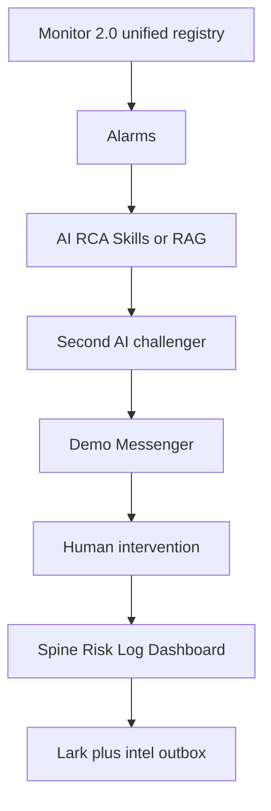
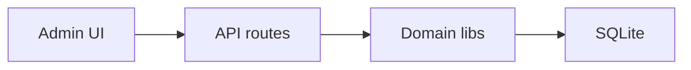
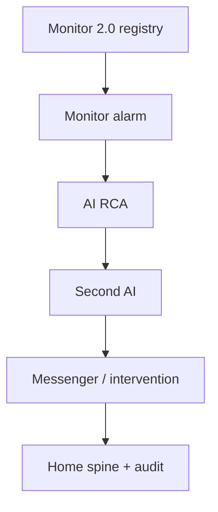
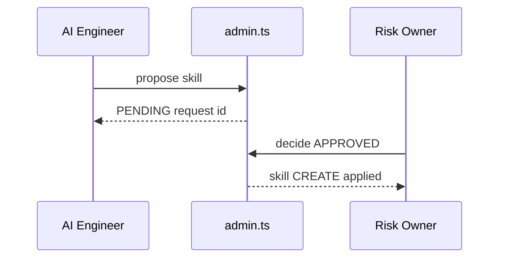
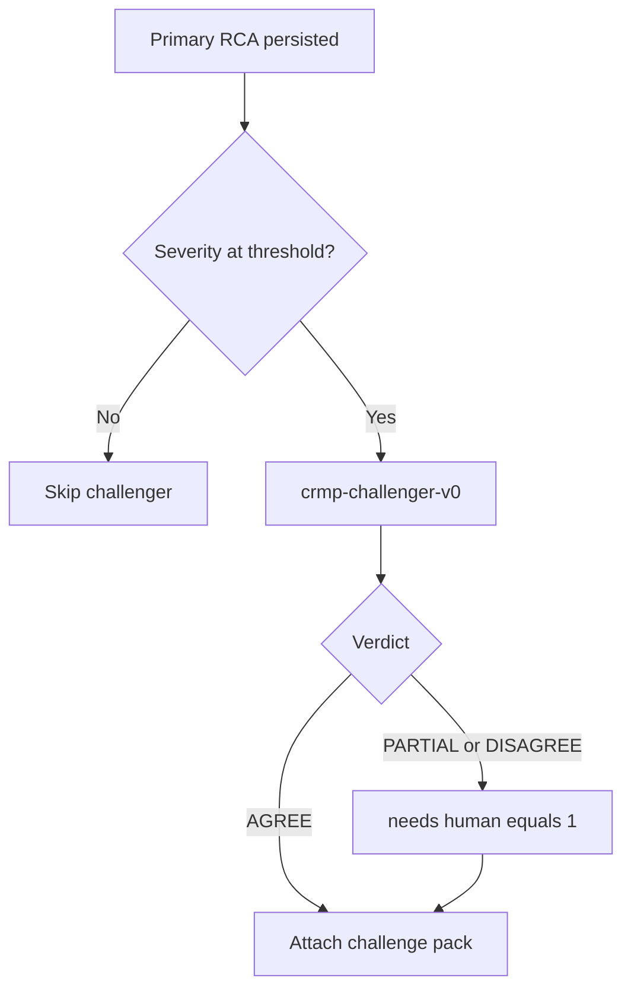
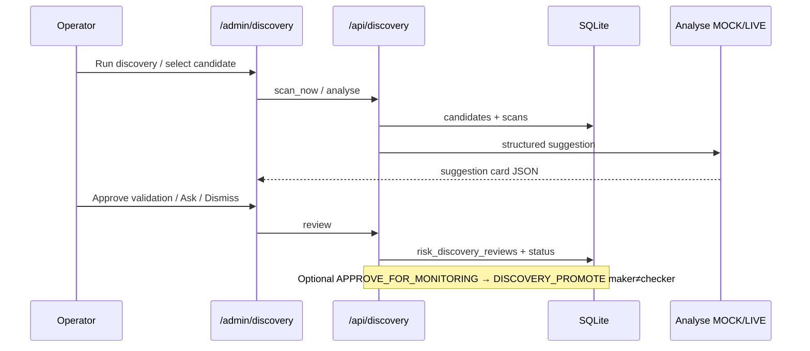
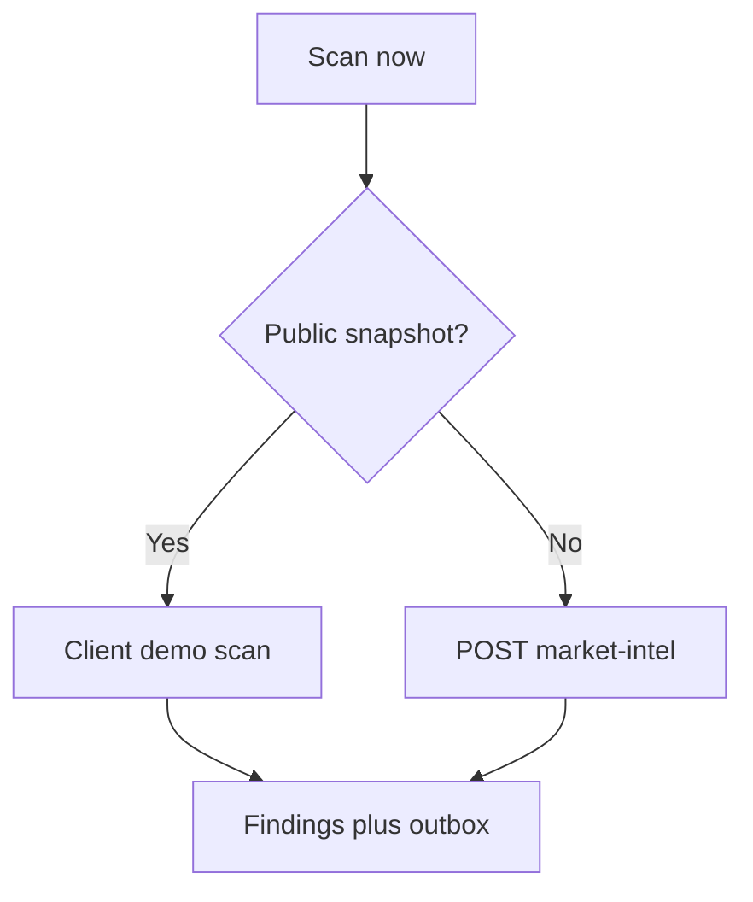

# Vantage CRMP — Technical Specification Design (TSD)

**Document ID:** CRMP-TSD-001  
**Version:** 1.16  
**Status:** Prototype / living spec  
**Products in scope:** CFD + Crypto Exchange  
**Primary stack:** Next.js 15 (App Router), React 19, SQLite (`better-sqlite3`), RBAC session auth  
**Owner:** demo platform owner  
**Companion:** [PRD](/admin/docs/prd) · [User Guide](/admin/docs/user-guide) · [UAT](/admin/docs/uat)

This TSD describes the technical design of the Centralised Risk Management Platform (CRMP) Admin Control Plane.  
**§8 AI Admin** and **§9 Second-AI Challenger** are first-class module specifications.

---

## 1. Purpose & scope

### 1.1 Purpose
Provide a single admin control plane where Risk, Ops, AI, and System operators can:
- Observe Monitor 2.0 indicators / alerts
- Run AI RCA (skills + RAG) with independent second-AI challenge on high severity
- Triage in Demo Messenger (evidence, chat, escalate, dismiss, close, controls)
- Enforce human gates on high-impact actions
- Govern AI configuration via maker/checker
- Review home spine stage ticket counts, risk analytics, market intel, and daily performance

### 1.2 In scope (prototype)
- Admin UI + SQLite persistence
- Monitor 2.0 (indicator + detector registry) → Alarm → AI RCA → Second opinion → Messenger / Intervention → home spine → Dashboard
- AI Admin governance (parameters, skills, RAG, training, accuracy)
- Risk scenario playbooks and linked timeline chains
- Demo Messenger + Lark channel registry (mock webhooks)
- AI Incident Workspace (`/admin/ai-incident`) — bilingual Monitor 2.0 HTML prototype (INC-1028 demo)
- Market Intelligence 5-minute scanner + outbox
- Bilingual docs (EN / zh-Hant) and responsive admin shell

### 1.3 Out of scope (production wiring)
- Live SSO / IdP
- Real Lark interactive cards / oneZero / wallet write adapters
- Production LLM billing + training cluster

---

## 2. System context



**AI Admin** sits beside the runtime spine: it does **not** execute live trading actions; it governs models, playbooks, RAG corpus, and AI parameters under dual control.

---

## 3. Architecture overview

| Layer | Responsibility | Key paths |
|---|---|---|
| UI (App Router) | RBAC-gated admin pages | `platform/src/app/admin/**` |
| Client consoles | Interactive tabs / forms | `platform/src/components/*` |
| API routes | JSON mutations + reads | `platform/src/app/api/**` |
| Domain libs | Business logic | `platform/src/lib/ai/*`, `lib/db.ts`, `lib/auth.ts` |
| Persistence | SQLite file | `platform/data/vantage_risk.db` |




### 3.1 Runtime spine stages
1. **Monitor 2.0** runs detector sampling on the unified indicator + detector registry (`/admin/monitor-2`; `/admin/detectors` redirects)
2. **Alarm** opens Monitor alert/ticket
3. **AI RCA** matches skill or RAG-reasons (list on **Realtime Alert & Tracker** `/admin/alerts`; detail `/admin/ai-analyses/[id]`)
4. **Second-AI Challenger** runs when severity ≥ threshold (`crmp-challenger-v0`)
5. **Demo Messenger / Human intervention** triage and gated controls
6. **Home spine** records stage transitions with ticket counts on Admin Home (`/admin`; `/admin/spine` redirects — Spine Log tab removed)


7. **Daily performance / Risk Log / Market Intel** aggregate outcomes

---

## 4. Data model (core)

### 4.1 Identity & RBAC
- `users`, `roles` (permission JSON), `departments`, `teams`, `sessions`
- Permissions are string codes; `SUPER_ADMIN` has `*`

### 4.2 Monitoring
- `monitor_indicators`, `monitor_alerts`, `monitor_tickets`
- `risk_domains`, `escalation_routes`, `lark_channels`

### 4.3 AI runtime
- `ai_skills` (+ `scenario_json`), `risk_scenario_chains`
- `rag_documents` (+ FTS)
- `ai_analyses` (+ `challenged`, `challenge_verdict`), `ai_analysis_evidence`, `ai_skill_runs`
- `ai_analysis_challenges` (second-opinion rows)
- `interventions`, spine tables

### 4.4 Messenger
- `messenger_threads`, `messenger_messages`, `messenger_pending_actions`

### 4.5 Market intelligence
- `market_intel_*` scan/findings/outbox tables (see `lib/market-intel/schema.ts`)

### 4.6 AI Admin governance
See **§8.4** — `ai_change_requests`, `ai_training_runs`, `ai_feedback`, `ai_accuracy_snapshots`, AI keys in `platform_settings`.

---

## 5. Security & RBAC (summary)

| Concern | Rule |
|---|---|
| Page access | `getCurrentUser()` + `hasPermission(role, code)` |
| Maker ≠ Checker | Proposer cannot approve own `ai_change_requests` when `ai.maker_checker_required=true` |
| AI Admin mutations | Only via `/api/ai-admin` with propose/approve permissions |
| Audit | `writeAudit` on propose, decide, feedback, training queue |
| **AI access blocklist** | Pages/functions/fields/data AI must never touch — see `/admin/security/ai-access` and `lib/security/ai-access-blocklist.ts` |

Detailed AI Admin permission matrix: **§8.3**.  
**Human-only surfaces (identity, secrets, dual-control approve, LP/wallet execute, role writes):** living list on **`/admin/security/ai-access`**.

---

## 6. Integration points

| System | Mode in prototype | Notes |
|---|---|---|
| Monitor 2.0 | Mirrored tables + sync / Run all / simulate | Indicator + detector registry on `/admin/monitor-2`; open alerts/tickets on Realtime Alert & Tracker |
| Demo Messenger | In-app threads + `/api/messenger` | Evidence, escalate, P0–P3 severity re-recommend, controls |
| Lark | Channel registry + mock webhook / intel outbox | Severity routing |
| Market intel feeds | Heuristic 5-min scanner | Card format i–vi |
| LP / Bridge / Wallets | Suggested actions + admin deep-links | Human gate before real adapters |
| Model training | Queued runs + seeded metrics | No GPU cluster in prototype |

---

## 7. Admin surface map

Source of truth for routes: `NAV_ITEMS` + `NAV_GROUPS` in `platform/src/lib/nav.ts`. Every row is specified in this TSD (this section + §8–§16) and has an operator how-to in the User Guide.

### 7.1 Shell (not a nav row)

| Surface | Route / store | Module | Permission |
|---|---|---|---|
| Login | `/login` | `app/login/page.tsx`, `lib/demo-session.ts` | public |
| Language | cookie `crmp_ui_lang` | `hooks/useUiLocale`, `lib/i18n.ts` | — |
| Unread badges | `crmp_nav_seen_v1` / `crmp_nav_extra_v1` | `AdminShell`, `lib/nav-badges.ts` | — |
| Demo session | `crmp_demo_session_v1` | persist named persona on Pages | — |
| Mobile drawer | `< lg` | `AdminShell` hamburger | — |
| Brand | Vantage logo + owner line | `VantageLogo`, `lib/platform-owner.ts` | — |

Unread formula: `max(0, mergeNavTotals(server) + extra − seen)`. Opening a href writes seen. `bumpNavBadge(href)` increments extra. Pages uses `FALLBACK_NAV_TOTALS` when SQLite counts are empty.

### 7.2 Pages

| Group | URL | UI / API | Permission | Spec |
|---|---|---|---|---|
| Overview | `/admin` | `app/admin/page.tsx` | `admin.access` | §16.2 |
| Monitor | `/admin/dashboard` | `DailyDashboardView`, `GET/POST /api/dashboard` | `dashboard.read` | §16.3 |
| Monitor | `/admin/risk-log` | `RiskLogDashboard`, `lib/ai/risk-log.ts` | `monitor.read` \| `audit.read` \| `dashboard.read` | §16.4 |
| Monitor | `/admin/market-intel` | `MarketIntelBoard` | `monitor.read` | **§12** |
| Monitor | `/admin/monitor-2` | unified registry + `MonitorActions`, `/api/monitor`, `/api/detectors` | `monitor.read` / `monitor.operate` | §16.5 |
| Monitor | `/admin/detectors` | redirects → Monitor 2.0 (bookmarks) | `detectors.read` | §16.5 |
| Monitor | `/admin/alerts` | **Realtime Alert & Tracker** · `AlertTrackerBoard` | `monitor.read` / `monitor.operate` | §16.7 |
| Monitor | `/admin/discovery` | **Unknown Risk Discovery** · `DiscoverySuggestionBoard` · `/api/discovery` | `monitor.read` / `ai.approve` | **§11A** |
| Monitor | `/admin/indicator-aggregation` | **Indicator Aggregation** · `IndicatorAggregationBoard` · `/api/indicator-aggregation` | `monitor.read` / `monitor.operate` | **§11.7** |
| Monitor | `/admin/ai-incident` | **AI Incident Workspace** · `AiIncidentWorkspace` · static HTML prototype | `monitor.read` | **§11.8** |
| Monitor | `/admin/risk-domains` | domain cards | `monitor.read` | §16.8 |
| AI | `/admin/ai-analyses` | redirects → Realtime Alert & Tracker (list); detail `[id]` | `ai.read` / `ai.operate` | §9 + §16.9 |
| AI | **`/admin/ai-admin`** | `AiAdminConsole`, `/api/ai-admin` | `ai.admin` | **§8** |
| AI | **`/admin/ai-performance`** | `AiPerformanceBoard`, `GET /api/ai-performance` | `ai.read` \| `ai.admin` | **§8A** |
| AI | `/admin/skills` · `/admin/skills/[code]` | `SkillsScenariosBoard` | `skills.read` | §10 + §16.10 |
| AI | `/admin/knowledge-tree` | `KnowledgeTreeBoard` | `rag.read` | §16.11 |
| AI | `/admin/rag` | `RagManager`, `/api/rag` | `rag.read` / `rag.manage` | §16.12 |
| Response | `/admin/messenger` | `DemoMessenger`, `/api/messenger` | `lark.read` | **§11** |
| Response | `/admin/interventions` | `InterventionsBoard` | `intervene.operate` | §16.14 |
| Response | `/admin/escalation` | `EscalationManager` | `escalation.read` / `.manage` | §16.15 |
| Response | `/admin/lark` | `LarkManager`, `/api/lark` | `lark.read` / `lark.manage` | §16.15 |
| Response | `/admin/spine` | redirects → Admin Home spine counts | `spine.read` | §16.13 |
| Org | `/admin/departments` | **BU and Teams** combined hub | `teams.read` | §16.16 |
| Org | `/admin/teams` | redirects → `/admin/departments` | `teams.read` | §16.16 |
| Org | `/admin/roles` | editable RBAC · `/api/roles` | `users.read` / `users.manage` | §16.16 |
| Org | `/admin/users` | `UsersManager`, `/api/users` | `users.read` / `users.manage` | §16.16 |
| Platform | `/admin/data-sources` | `DataSourcesManager` | `sources.read` / `.manage` | §16.17 |
| Platform | `/admin/security/ai-access` | `AiAccessSecurityBoard` | `audit.read` \| `settings.manage` \| `users.read` \| `ai.admin` | §5 + §16.18 |
| Platform | `/admin/audit` | `AuditBoard` — CRMP / Vantage Markets Admin tabs + Roll back | `audit.read` | §16.19 |
| Platform | `/admin/settings` | `SettingsManager`, `PATCH /api/settings` | `settings.manage` | §16.20 |
| Docs | `/admin/docs/user-guide` · `prd` · `tsd` · `uat` · `ecosystem` · `roadmap` · `open-issues` · `progress` · `urls` | `lib/docs.ts`, boards | `admin.access` | §13 + §16.21 |
| Shell | `SelectionChatbot` (select text → sparkle → chat) | `lib/ai/desk-chat.ts`, `POST /api/ai-chat` | public / `ai.read` | §12 |

Static export: `next.config` `output: 'export'`, `basePath: '/PRD/crmp-admin'`, `trailingSlash: true`. Client detects `isPublicSnapshot()` / `NEXT_PUBLIC_STATIC_EXPORT` and uses demo fallbacks instead of `/api`.

---

## 8. AI Admin Management Page — full specification

### 8.1 Purpose
`/admin/ai-admin` is the **AI control plane**. Operators use it to:
1. Observe AI health KPIs and accuracy history
2. Propose changes to AI parameters, skills, and RAG documents
3. Approve/reject those changes under **maker/checker dual control**
4. Queue training / recalibration runs
5. Label RCA quality feedback (CORRECT / INCORRECT / PARTIAL)

It is **governance**, not the live RCA workbench (list on **Realtime Alert & Tracker** `/admin/alerts`; detail `/admin/ai-analyses/[id]`), not the intervention desk (`/admin/interventions`), and not the dedicated read-only evaluation board (`/admin/ai-performance` — **§8A**).

### 8.2 Route & components

| Item | Spec |
|---|---|
| Page route | `GET /admin/ai-admin` → `platform/src/app/admin/ai-admin/page.tsx` |
| UI component | `AiAdminConsole` (`platform/src/components/AiAdminConsole.tsx`) client console |
| API | `GET/POST /api/ai-admin` → `platform/src/app/api/ai-admin/route.ts` |
| Domain logic | `platform/src/lib/ai/admin.ts` |
| Schema | `platform/src/lib/ai/admin-schema.ts` via `ensureAiAdminSchema` |
| Seed | `seedAiAdminIfEmpty` (params, training runs, accuracy snapshots, demo CRs) |

### 8.3 Access control

#### 8.3.1 Page view (any of)
- `ai.admin`
- `skills.manage`
- `rag.manage`
- `ai.read`

Unauthorized users redirect to `/admin`.

#### 8.3.2 Maker (propose) — any of
- `ai.propose`
- `skills.manage`
- `rag.manage`
- `settings.manage`

#### 8.3.3 Checker (approve/reject) — any of
- `ai.approve`
- `skills.approve`
- `rag.approve`

#### 8.3.4 Role mapping (prototype)

| Role | View AI Admin | Maker | Checker | Notes |
|---|---|---|---|---|
| `AI_ENGINEER` | Yes | Yes | No | Proposes skills/RAG/params/training |
| `RISK_OWNER` | Yes | Yes* | Yes | Primary checker; may also propose |
| `RISK_ANALYST` | Yes | Yes | No | Propose + operate feedback |
| `SUPER_ADMIN` | Yes | Yes | Yes | Full; still blocked from self-approve when maker≠checker enforced |
| `OPS_LEAD` / `SYSTEM_ADMIN` | Limited / via perms | Per ROLE_DEFS | Per ROLE_DEFS | See `ROLE_DEFS` in `db.ts` |
| `VIEWER` | No (unless granted) | No | No | Read-only elsewhere |

\* Risk Owner has both propose and approve; self-approval of own CR is still rejected.

#### 8.3.5 Maker ≠ Checker rule
When `platform_settings.ai.maker_checker_required != "false"`:
- `decideChangeRequest` throws if `proposed_by === decided_by`
- UI should only show Approve/Reject to checkers who are not the proposer

### 8.4 Data model

#### 8.4.1 `ai_change_requests`
| Column | Type | Notes |
|---|---|---|
| `id` | INTEGER PK | |
| `request_id` | TEXT UNIQUE | e.g. `CR-A1B2C3D4` |
| `entity_type` | TEXT | `PARAM` \| `SKILL` \| `RAG` \| `TRAINING` |
| `action` | TEXT | `UPDATE` \| `CREATE` \| `DISABLE` \| `RETIRE` \| … |
| `title`, `summary` | TEXT | Human-readable |
| `payload_json` | TEXT | After-state / create payload |
| `before_json` | TEXT NULL | Prior state for diffs |
| `status` | TEXT | `PENDING` \| `APPROVED` \| `REJECTED` |
| `proposed_by` / `proposed_at` | FK / timestamp | Maker |
| `decided_by` / `decided_at` / `decision_note` | FK / timestamp / TEXT | Checker |

#### 8.4.2 `ai_training_runs`
Tracks queued/running/completed recalibrations: `run_id`, `model_name`, `dataset_label`, metrics (`accuracy`, `precision_score`, `recall_score`, `f1_score`), `samples`, `status`, timestamps, `created_by`.

#### 8.4.3 `ai_feedback`
Per-analysis labels: `CORRECT` \| `INCORRECT` \| `PARTIAL`, optional note, `rated_by`.

#### 8.4.4 `ai_accuracy_snapshots`
Daily rollup: skill-match rate, human-agree rate, feedback-correct rate, analyses total, intervention approved/rejected counts. Overview refresh upserts `date('now')` live snapshot.

#### 8.4.5 Governed parameters (`platform_settings` keys)
| Key | Purpose | Default (seed) |
|---|---|---|
| `ai.rca_enabled` | Master RCA switch | `true` |
| `ai.auto_on_alarm` | Auto-trigger RCA on alarm | `true` |
| `ai.skill_certainty_only` | Auto-exec skills only on certainty match | `true` |
| `ai.min_confidence` | Min confidence before auto-complete | `0.55` |
| `ai.rag_top_k` | Top-K RAG docs | `6` |
| `ai.second_opinion_severity` | Severities for challenger AI | `BREACH` |
| `ai.maker_checker_required` | Enforce dual control | `true` |
| `detectors.auto_raise_alarms` | Detectors raise Monitor alarms | `true` |

Only keys starting with `ai.` or `detectors.auto_raise_alarms` may be applied via AI Admin PARAM changes.

### 8.5 UI specification (tabs)

Console tabs (client state):

| Tab ID | Label | Functions |
|---|---|---|
| `overview` | Overview | KPI cards: analyses total, skill-match %, avg confidence, needs-human, interventions pending, human-agree %, feedback-correct %, pending CRs. Recent analyses list with feedback labels. |
| `params` | Parameters | Editable drafts for AI settings; **Propose** creates PARAM CR (does not apply immediately). |
| `changes` | Maker / Checker | List CRs (PENDING first). Checker Approve / Reject with note. Shows maker name, before/after payload. Pending count badge on tab. |
| `skills` | Skills | List skills; form to **propose CREATE** skill (code, name, description, indicator patterns, owner dept, human step). Actual apply on approve. Link out to `/admin/skills` for scenario board. |
| `rag` | RAG | List documents (excerpt); form to **propose CREATE** RAG doc; apply on approve (+ FTS reindex). |
| `training` | Training | List runs + metrics; form to **queue training** (creates TRAINING CR). |
| `history` | History & accuracy | Accuracy snapshot table (14 days). |

Header badges show current `role_code`, **Maker**, and/or **Checker** capability.

### 8.6 API specification

#### 8.6.1 `GET /api/ai-admin`
Query:
- `tab` = `overview` (default) \| `params` \| `changes` \| `training` \| `skills` \| `rag`
- `status` (optional, for changes filter)

Auth: view permissions (§8.3.1).  
Default response includes `{ overview, params, changes, training, skills, rag, roles }`.

#### 8.6.2 `POST /api/ai-admin`
JSON body with `action`:

| `action` | Permission | Effect |
|---|---|---|
| `propose` | Maker | Generic CR insert |
| `propose_param` | Maker | PARAM UPDATE CR for `key`/`value` |
| `propose_skill` | `skills.manage` or `ai.propose` | SKILL CREATE/UPDATE/… CR |
| `propose_rag` | `rag.manage` or `ai.propose` | RAG CREATE/UPDATE/… CR |
| `decide` | Checker | `APPROVED` applies payload; `REJECTED` closes CR. Enforces maker≠checker |
| `queue_training` | Maker | TRAINING CREATE CR |
| `feedback` | `ai.operate` or `ai.admin` | Insert `ai_feedback` row |

Error model: `{ error: string }` with HTTP 400/403.

### 8.7 Apply semantics (on APPROVED)

| entity_type | action | Apply behaviour |
|---|---|---|
| `PARAM` | `UPDATE` | Update `platform_settings.value` |
| `SKILL` | `CREATE` | Insert `ai_skills` ACTIVE |
| `SKILL` | `UPDATE` | Patch fields (name, patterns, steps, status, …) |
| `SKILL` | `DISABLE` | `status='DISABLED'` |
| `RAG` | `CREATE` | Insert doc + `reindexRagFts` |
| `RAG` | `UPDATE` | Content/status update + reindex |
| `RAG` | `RETIRE` | `status='RETIRED'` + reindex |
| `TRAINING` | `CREATE` | Insert `ai_training_runs` QUEUED |

Unsupported pairs throw and leave CR undecided (transactional expectation for production: wrap apply+status update).

### 8.8 Audit events
| Event | When |
|---|---|
| `AI_CHANGE_PROPOSED` | Maker submits CR |
| `AI_CHANGE_APPROVED` / `AI_CHANGE_REJECTED` | Checker decides |
| `AI_FEEDBACK` | Feedback label submitted |

### 8.9 Non-functional requirements
| NFR | Spec |
|---|---|
| Latency | Page SSR + client tabs; API mutations < 500ms p95 in prototype |
| Durability | SQLite WAL; audit trail retained |
| Safety | No direct apply of PARAM/SKILL/RAG without CR when maker/checker required |
| Separation | Runtime interventions remain on `/admin/interventions` |
| Observability | Overview KPIs + accuracy snapshots |

### 8.10 UX / acceptance criteria
1. AI Engineer can open AI Admin and propose a skill; CR appears PENDING.
2. Same AI Engineer **cannot** approve that CR (error: maker/checker).
3. Risk Owner can approve; skill becomes ACTIVE and visible on `/admin/skills`.
4. Parameter propose does not change live value until APPROVED.
5. Training queue creates CR then TRAINING run on approve.
6. Overview shows pending CR count and accuracy history.
7. Feedback labels persist and affect feedback-correct rate.

### 8.11 Sequence — propose skill (happy path)



### 8.12 Related pages
| Page | Relationship |
|---|---|
| `/admin/ai-performance` | Read-only evaluation board (§8A) — KPIs shared via `getAiPerformanceEval` |
| `/admin/skills` | Runtime playbook / scenario board (post-approve view) |
| `/admin/rag` | Corpus browser; create/update should prefer AI Admin CR path for governed changes |
| `/admin/ai-analyses` | Consumes skills/RAG/params governed here |
| `/admin/interventions` | Human gates for **runtime** actions (not config CRs) |
| `/admin/roles` | Defines permissions listed in §8.3 |

### 8.13 Future enhancements (not yet required)
- Diff UI for `before_json` vs `payload_json`
- Mandatory dual approval for CRITICAL severity param changes
- Webhook notify Lark `oc_ai_detection_lab` on PENDING CR
- Export CR pack for compliance

---

## 8A. AI Performance Evaluation Board

### 8A.1 Purpose
`/admin/ai-performance` is the **read-only** health board for AI quality. Operators use it to evaluate skill match, challenger agreement, human feedback accuracy, how-to-improve reviews, and training metrics **before** proposing model/threshold changes on AI Admin.

It does **not** expose maker/checker forms. Mutations remain on `/admin/ai-admin`.

### 8A.2 Route & components

| Item | Spec |
|---|---|
| Page route | `GET /admin/ai-performance` → `platform/src/app/admin/ai-performance/page.tsx` |
| UI component | `AiPerformanceBoard` (`platform/src/components/AiPerformanceBoard.tsx`) |
| API | `GET /api/ai-performance` · also `GET /api/ai-admin?tab=performance` |
| Domain logic | `getAiPerformanceEval()` in `platform/src/lib/ai/admin.ts` (extends `getAiAdminOverview`) |

### 8A.3 Access control
Same view gate as AI Admin overview: any of `ai.admin` · `ai.read` · `skills.manage` · `rag.manage`. Unauthorized → redirect `/admin`.

### 8A.4 Data & KPIs
| Source | Metrics |
|---|---|
| `ai_analyses` | totals, skill/RAG mode counts, confidence, needs_human, challenge rate |
| `ai_analysis_challenges` | agree / partial / disagree → agree rate |
| `ai_feedback` | correct / incorrect / partial → feedback accuracy |
| `interventions` | approved ÷ decided → human agree rate |
| `ai_improvement_reviews` | total / open / satisfactory |
| `ai_training_runs` | completed / running / queued; avg accuracy & F1; recent rows |
| `ai_accuracy_snapshots` | last 14 days (today refreshed live) |
| `platform_settings` | line1 / line2 model + second-opinion severity badges |
| `severity_feedback` + monthly pack | P0–P3 re-recommend counts; suggested escalation coefficients (read-only mirror of Escalation Routes pack) |
| Weekly formula pack | `getWeeklyFormulaSuggestion` → `severity_formula_weekly` / `ai-perf-severity-formula` (read-only; RO approve only on Escalation) |

### 8A.5 UX / acceptance
1. Left nav **AI Performance** under AI & knowledge.
2. Board renders KPI strip + challenger / feedback / improve / training / history / recent lists (`data-testid="ai-performance-board"`).
3. Panel `ai-perf-severity-weights` shows monthly P0–P3 → factor-weight suggestion (links to Escalation / Messenger; no apply button).
4. Panel `ai-perf-severity-formula` mirrors the weekly severity formula pack (factor diffs / CR status; no RO approve).
5. No propose/approve controls on the page.
6. Links to AI Admin and Realtime Alert & Tracker.
7. EN / zh-Hant chrome via `EnZh` + page meta `ai-performance`.

---

## 9. Independent Second-AI Challenger

### 9.1 Purpose
For alert severities at or above `ai.second_opinion_severity` (default **BREACH**), the platform runs an independent challenger model (`crmp-challenger-v0`) after the primary skill/RAG RCA. The challenger **must not** reuse the primary decision path (separate heuristics / future separate vendor).

**Code:** `platform/src/lib/ai/challenger.ts` · wired from `analyze.ts` after skill/RAG persist.

### 9.2 Trigger
| Setting | Default | Behaviour |
|---|---|---|
| `ai.second_opinion_severity` | `BREACH` | Run when alert severity rank ≥ setting (`WARN` &lt; `BREACH` &lt; `CRITICAL`) |




### 9.3 Outputs
| Field | Description |
|---|---|
| `verdict` | `AGREE` / `PARTIAL` / `DISAGREE` |
| `critiques` | Material gaps in primary narrative |
| `improvements` | Prioritised recommendations (`HYPOTHESIS` / `EVIDENCE` / `ACTION` / …) |
| `alternatives` | Competing hypotheses with confidence |

### 9.4 Persistence & side-effects
- Table `ai_analysis_challenges` (1:1 with `ai_analyses`)
- Evidence row type `CHALLENGER`
- Columns `ai_analyses.challenged`, `challenge_verdict`
- `PARTIAL` / `DISAGREE` forces `needs_human = 1`
- Spine stage `AI_RCA` event + audit `AI_SECOND_OPINION`
- Lazy backfill via `getAnalysisBundle` / `POST /api/ai` action `backfill_challenges`

### 9.5 UI
- List badges: `2nd AI · {verdict}`
- Detail panel: `AiChallengePanel`
- Controls: simulate CRITICAL, backfill challenges

---

## 10. Skills & risk scenarios (summary)

Skills store rich `scenario_json`: indicator, thresholds + why, fault areas, escalation, BU corrections, past cases.  
`risk_scenario_chains` link multi-indicator timelines. See `/admin/skills`, `risk-scenarios-catalog.ts`, `risk-scenarios-extra.ts`.

---

## 11. Demo Messenger

### 11.1 Purpose
In-app Lark-style inbox for alert + AI report threads with inline operator actions. Production transport remains Lark; this module proves UX and audit semantics.

### 11.2 Stack
| Item | Path |
|---|---|
| Page | `/admin/messenger` → `app/admin/messenger/page.tsx` |
| UI | `components/DemoMessenger.tsx` (mobile master-detail) |
| API | `GET/POST /api/messenger` |
| Domain | `lib/messenger/demo.ts` |

### 11.3 Actions
| Action | Effect |
|---|---|
| `show_evidence` | Post vault + challenger summary into thread |
| `chat` | User note / challenge; disagreement flags `needs_human` |
| `escalate` | Advance escalation path step; post hand-off in the current POC window and intake in the next |
| `dismiss` | False alarm → thread DISMISSED, alert CLOSED |
| `close` | Accept AI → thread CLOSED |
| `recommend_severity` | Desk re-recommends P0–P3 + reason on AI_REPORT card → `severity_feedback` (+ SYSTEM bubble); feeds monthly weight pack |
| `recommend` → `confirm_action` | Double-confirm control → admin_ref (+ checker if required) |

### 11.4 Data
`messenger_threads`, `messenger_messages`, `messenger_pending_actions`, `severity_feedback` (P0–P3 re-recommendations + reason codes / `week_key`; see `lib/severity-feedback.ts` + `lib/severity-formula.ts`). Live formula: `severity.formula.live`. Weekly CR: `ai_change_requests` `SEVERITY_FORMULA`. Monthly pack: `getMonthlyWeightSuggestion` → Escalation Routes apply → ESC-DEFAULT `coefficients_json`.

### 11.5 POC windows
`getMessengerThread` returns `poc_windows` — one Lark chat per hop on the matched route (primary team → secondary → Risk Owner → Exec) with named POC from `users`/`teams`. UI: bird-eye path chips + split columns (`data-testid=msg-poc-windows`).

### 11.6 Severity formula optimisation loop + monthly escalation weights (FR-39)

**Primary loop — live formula → ops reason codes → weekly AI → RO approve**

| Item | Spec |
|---|---|
| Live formula | `platform_settings` key `severity.formula.live` (`SeverityFormula`: factors, weights, P bands) |
| Score | Client-safe `lib/severity-formula-score.ts` · catalogue `lib/severity-formula-shared.ts` · server `lib/severity-formula.ts` |
| Ops UI | Messenger `msg-severity-recommend` + `msg-sev-confirm-accurate` + `msg-sev-reason-codes` on open AI_REPORT; **Monitor 2.0 surfaces** (`msg-monitor-surfaces` / `monitor_links` via `monitor2DeepLinks`) |
| Ops action | `POST /api/messenger` `action=recommend_severity` `{ recommended_p, reason, reason_codes }` — `ai_accurate` confirms AI P (monthly “same”) |
| Feedback row | `severity_feedback` (+ `reason_codes_json`, `week_key`, `formula_version`, `formula_p`, `month_key`) |
| Weekly AI | `getWeeklyFormulaSuggestion` / `proposeWeeklyFormulaChange` → enable/disable factors, weight deltas, threshold nudges |
| CR | `ai_change_requests` entity `SEVERITY_FORMULA` · AI Engineer maker · Risk Owner checker (`ai.approve`) |
| Escalation UI | `SeverityFormulaBoard` `sev-formula-loop` on `/admin/escalation` · Propose / `sev-formula-ro-approve` |
| Apply | `decideChangeRequest` → `applySeverityFormulaPayload` → updates `severity.formula.live` |
| AI Performance | Read-only weekly pack via `severity_formula_weekly` / `ai-perf-severity-formula` |
| Guards | `npm run test:severity-formula` · `test:severity-formula-smoke` (plus monthly guards below) |

**Secondary loop — monthly ESC-DEFAULT coefficient pack**

| Item | Spec |
|---|---|
| Domain | `lib/severity-feedback.ts` — `getMonthlyWeightSuggestion`, `applyMonthlyWeightSuggestion` |
| Escalation UI | `EscalationManager` panel `esc-severity-weight-pack`; apply → `POST /api/escalation` `apply_severity_weights` |
| AI Performance | Read-only pack via `getAiPerformanceEval().severity_weight_pack` |
| Mapping | P0=CRITICAL · P1=BREACH · P2=WARN · P3=INFO |
| Guards | `npm run test:severity-feedback` · `test:severity-feedback-smoke` |

Weekly formula changes require RO approval (maker ≠ checker). Monthly coefficients: AI suggests; only humans with `escalation.manage` apply to ESC-DEFAULT (`SEVERITY_WEIGHTS_APPLY`, stamp `severity.weights.applied.{YYYY-MM}`).

### 11.7 Indicator aggregation linear flow (FR-40)

| Item | Spec |
|---|---|
| Surface | `/admin/indicator-aggregation` · `IndicatorAggregationBoard` · homepage `HomeL1L2AggregationDemo` |
| API | `GET/POST /api/indicator-aggregation` — `start`, `inject_related`, `close_window`, `force_aggregate`, `continue_post_flow` |
| Domain | `lib/indicator-aggregation.ts` (+ client-safe `indicator-aggregation-shared.ts` · `computeL2Severity`) |
| Definitions | Built from `risk_scenario_chains` / `LINKED_SCENARIOS` (member monitors + window from sequence span) |
| Sessions | `platform_settings` key `indicator.aggregation.sessions` (+ `l1_severities`, `l2_severity` / `l2_severity_calc`, `force_aggregated`, `missing_l1_at_force`, `post_flow`) |
| Linear steps | SINGLE_ALERT → SKILL_RAG_LOOKUP → AGGREGATE_CHECK → SINGLE_CONTINUE \| CORRELATED_WAIT → RO_SINGLE \| AGGREGATE_READY → RO_AGGREGATE |
| Outcomes | `PENDING` · `SINGLE_NO_MEMBERSHIP` · `SINGLE_WINDOW_TIMEOUT` · `AGGREGATED` · `FORCE_AGGREGATED` |
| L2 severity | After natural or force aggregate: **floor = max(fired L1)**; × severity weight (+ multi-L1 nudge); ≤ one-band upgrade; never below floor; UI panel on board + homepage |
| Post-L2 | `POST_L2_FLOW_STAGES` starts with `L2_SEVERITY` → AI_RCA → MESSENGER → HUMAN_GATE → CONTROL |
| Guards | `npm run test:indicator-aggregation` · `test:indicator-aggregation-smoke` |

### 11.8 AI Incident Workspace (bilingual Monitor 2.0 HTML prototype)

Hosted demo of the **Monitor2_AI_Report_Web_Bilingual_v3** interactive incident report inside CRMP Admin. **Demo data only** — no production AI or Lark calls.

| Item | Spec |
|---|---|
| Surface | `/admin/ai-incident` · `AiIncidentWorkspace` · iframe + full-page link |
| Static asset | `public/prototypes/monitor2-ai-report.html` |
| Demo incident | **INC-1028** — LP-A · XAUUSD · Pricing Engine SG-02 · P2 (quote age / freeze KPIs; 3 L1 → 1 L2) |
| Modes | Web Console ↔ Lark · **Static** (read-only; ACK/assign/escalate blocked) ↔ **Dynamic** (investigate Fallback / impact / history / market / Admin logs) · 中文 ↔ EN |
| Evidence | RCA hypotheses with **E-01…E-08** (SQL/API samples); nested human-feedback taxonomy; on-call roster + escalation chain; JSON export `INC-1028-demo-report.json` |
| Messenger seed | `ensureInc1028MessengerThread` in `lib/messenger/demo.ts` → `THR-INC-1028` AI_REPORT with `monitor_links` / `workspace_url` → `/admin/ai-incident` |
| Deep links | `lib/monitor-deep-links.ts` includes `ai_incident` |
| Guards | `npm run test:ai-incident` · `test:ai-incident-smoke` |
| Operator / UAT | User Guide §14C · UAT-49 |

---

## 11A. Unknown Risk Discovery (AI suggestion card)

**Surface:** `/admin/discovery` · **API:** `/api/discovery` · **UI:** `DiscoverySuggestionBoard`  
**Tables:** `risk_discovery_candidates`, `risk_discovery_scans`, `risk_discovery_reviews`  
**Settings:** `discovery.enabled`, `discovery.auto_on_detectors`  
**Spine stages:** `DISCOVER` · `DISCOVERY_REVIEW` · `DISCOVERY_PROMOTE`  
**Notebook URLs:** `lib/ai/discovery-links.ts` (HTML + Colab; safe for client bundles)

### 11A.1 Modules
| Module | Role |
|---|---|
| `lib/ai/discovery.ts` | Feature window sample; seven method scanners; persist candidates/scans; review + promote |
| `lib/ai/discovery-analyse.ts` | MOCK / LIVE structured suggestion card (`OPENAI_API_KEY` server-only) |
| `lib/ai/discovery-schema.ts` | SQLite tables + default settings |
| `lib/ai/discovery-links.ts` | Public notebook URLs |
| `components/DiscoverySuggestionBoard.tsx` | Notebook-parity controls + suggestion card |
| `app/api/discovery/route.ts` | `scan_now`, `connect_openai`, `disconnect_openai`, `analyse`, `review`, `toggle_enabled` |
| `app/api/monitor/route.ts` | Parallel `runDiscoveryParallel` on `run_detectors` when auto flag is true |

### 11A.2 Data needed
| Source | Use |
|---|---|
| `monitor_indicators` (unpaused rows: last_value, thresholds, product, domain) | ~48-step synthetic realtime feature window for scanners |
| `risk_discovery_*` tables | Candidates, scan runs, immutable review audit |
| `OPENAI_API_KEY` (optional env) | LIVE Analyse; never client-supplied |
| Session user with `monitor.read` / `ai.approve` | Operate vs review |

No raw client PII. Candidate `evidence_json` holds method scores and anchor monitor ids only.

### 11A.3 Methods (notebook families)
Implemented in `discovery.ts` against the feature window:

| Key | Family | Signal |
|---|---|---|
| `isolation_forest` | Isolation Forest | Multivariate / point anomaly proxy |
| `cusum` | CUSUM | Sustained regime shift (e.g. LP reject) |
| `mahalanobis` | Joint distance | Jointly unusual multi-series state |
| `lof` | LOF | Peer-relative local outlier |
| `subgroup` | Subgroup slice | Product × domain contrast |
| `sequence` | Lead-lag | Precursor / sequence pattern |
| `corr_network` | Correlation network | Cross-indicator dependency shift |

Each hit → fingerprint dedupe → `PENDING_RO` row with proposed `M2-DISC-*` / `SKILL-DISC-*`.

### 11A.4 Flow


1. `runDiscoveryParallel` (manual `scan_now` or parallel with detectors) writes `PENDING_RO`  
2. Session AI mode: Mock default; Connect OpenAI only if server key present  
3. `analyse` → suggestion card fields (assessment, causes, scenario, formula, dimensions, validation, limitations, priority, confidence, analysis_source)  
4. `review`: `APPROVE_FOR_VALIDATION` | `ASK_MORE_INFO` | `DISMISS` — AI cannot write these  
5. Optional `APPROVE_FOR_MONITORING` → `DISCOVERY_PROMOTE` propose/decide → skill + detector seed  

### 11A.5 Interaction (notebook parity)
| Control | Behaviour |
|---|---|
| Connect OpenAI / Disconnect Mock | Session AI mode; live requires server key |
| Analyse selected | Returns structured suggestion card JSON |
| Approve for validation | Human gate for BU/UAT — no deploy |
| Ask for more info | Records review + may refresh suggestion (not an approval) |
| Dismiss | Closes candidate |
| Approve for monitoring | Optional: `DISCOVERY_PROMOTE` via AI Engineer propose → RO decide → skill + detector |
| Open Jupyter (Colab) / HTML / Download .ipynb | Header + board links from `RISK_DISCOVERY_NOTEBOOK` (Colab, HTML Pages, raw `.ipynb`) |

Parallel to `run_detectors` when `discovery.auto_on_detectors=true`. Product: PRD §6.5 · Operator: User Guide §14A.

---

## 12. Market Intelligence

### 12.1 Purpose
Five-minute scan of news/social/official signals that can move LP prices; push formatted cards to a dedicated messenger/outbox channel; expose indicator `M2-MKT-INTEL`.

### 12.2 Key modules
- `lib/market-intel/scanner.ts`, `format.ts`, `schema.ts`, `demo-scan.ts`
- UI `/admin/market-intel`
- Settings: `market_intel.enabled`, `interval_minutes`, `lark_chat_id`

### 12.3 Public snapshot (GitHub Pages)
Pages has no Next.js API routes. `POST /api/market-intel` would return **405**. The desk therefore:
1. Detects `github.io` / `/PRD/crmp-admin` / `NEXT_PUBLIC_STATIC_EXPORT`.
2. Runs `runClientMarketIntelScan()` from the same `EVENT_TEMPLATES` as the live scanner.
3. Updates Findings, outbox, scan log and `M2-MKT-INTEL` in local state (persisted in `localStorage`).
4. Seeds three findings at SSG time so the first paint is not empty.



---

## 13. Docs, i18n & responsive shell

| Concern | Design |
|---|---|
| Docs | Markdown under `platform/docs/*` rendered via `lib/docs.ts` + `DocArticlePage` |
| Locales | `en` / `zh-Hant` query `?lang=` |
| UI chrome i18n | Cookie `crmp_ui_lang`; nav labels in `lib/i18n.ts` |
| Mobile | `AdminShell` drawer &lt; `lg`; messenger list/thread panes; safe-area CSS |

Interactive UAT board: `/admin/docs/uat` (`UatChecklistBoard` + `lib/docs/uat-cases.ts`).

---

## 14. Key API map (prototype)

Absent on GitHub Pages (static export). UI must degrade: demo session, client intel scan, local settings message.

| API | Role |
|---|---|
| `POST /api/auth/login` | Session cookie `crmp_session`; Pages falls back to `writeDemoSession` |
| `POST /api/auth/logout` | Clear cookie |
| `GET/POST /api/ai` | Analyses, simulate alarm, `backfill_challenges` |
| `GET/POST /api/ai-admin` | Propose/approve/training/feedback |
| `GET/POST /api/messenger` | Threads + inline actions |
| `GET/POST /api/lark` | Channel registry / mock notify |
| `GET/POST /api/market-intel` | Scan / findings / outbox |
| `GET/POST /api/discovery` | Unknown-risk candidates; Connect OpenAI/Mock; Analyse; RO review |
| `GET/POST /api/monitor` | Primary Monitor hub API: `run_detectors` (+ parallel discovery), `run_discovery`, `toggle_pause`, `update_thresholds`, `sync_monitor2`, `ack_alert`, `update_ticket` |
| `GET/POST /api/detectors` | Legacy detector CRUD / run (UI on Monitor 2.0) |
| `GET/POST /api/escalation` | Routes + dimension coefficients + ESC-DEFAULT probe; `?severity_weights=1` monthly pack; `apply_severity_weights` |
| `GET/POST /api/roles` | Editable RBAC (`update_role`; AI actors forbidden) |
| `GET/POST /api/org` | Departments + teams; `update_team` mission / on-call |
| `POST /api/audit/rollback` | Restore before-state snapshot by `audit_id` |
| `GET/POST /api/ai-improve` | How-to-improve review chat |
| `POST /api/ai-chat` | Desk selection chatbot |
| `POST /api/dashboard` | Rebuild daily metrics |
| `GET/POST /api/rag` | List, retrieve; human write / propose_rag (AI blocked) |
| `GET/POST /api/users` | Directory + create/disable |
| `PATCH /api/settings` | Single key save |
| Interventions | Server action `decideInterventionAction` (approve/reject) |

---

## 15. Deployment (prototype)

```bash
cd platform
npm install
npm run dev   # http://localhost:3000
```

SQLite path: `platform/data/vantage_risk.db`.  
Reset: `npm run db:reset` then restart.

Demo logins: see User Guide §1 (e.g. `admin@vantagemarkets.com` / `admin123`).

---

## 16. Remaining admin modules

Modules not fully specified in §8–§13. Behaviour must match the User Guide how-to and PRD §6.4.

### 16.1 Login, session, shell, unread — §7.1

- Personas: `DEMO_PERSONAS` in `lib/demo-session.ts` (demo platform owner first).  
- Localhost: `POST /api/auth/login` sets `crmp_session` **and** writes demo session.  
- Pages / 404/405: skip API, `writeDemoSession` only.  
- `AdminShell` prefers demo session when `isPublicSnapshot()`. Sign out clears both.  
- Nav groups from `NAV_GROUPS`. Unread: `AdminShell` + `bumpNavBadge` from Market Intel, Monitor 2.0, Realtime Alert & Tracker, Messenger.

### 16.2 Admin Home

SSR counts (users, teams, sources, domains, open alerts/tickets, Lark channels, routes). Every tile is a `Link`: `StatCard` `href` (with icon + Open), owner → `/login`, messenger hero → `/admin/messenger`, jump grid, department cards to working pages (alerts / interventions / settings), recent alerts to `/admin/alerts#{alert_id}`, spine steps to monitor / alerts / escalation / AI / dashboard. `HomeDummyAlertButtons` POST `/api/ai` `dummy_spine` (single or group) walks DETECT→close; locale from `getUiLocale()` so messenger notes store zh-Hant when the UI is 繁中; stored English titles/messages still display via `phrase()`. `AlertTrackerBoard` honours the hash and `?dummy=` highlight.

### 16.3 Daily performance

`getDailyDashboard()` → CFD/crypto metric arrays + WARN/BREACH summary. `POST /api/dashboard` refresh.

### 16.4 Risk log

`getRiskLogDashboard()` aggregates: summary USD/times, `by_category`, `by_domain`, `loopholes`, chronological `records`. Read-only UI (`RiskLogDashboard`).

### 16.5 Monitor 2.0 hub (unified indicator + detector registry)

Single registry table: `monitor_indicators` LEFT JOIN `detectors` (per-indicator detector code, pause, last run). **Run all indicators** / **Sync** / **Pause** via `MonitorEngineActions` + `MonitorActions`; threshold edit via `IndicatorThresholdEditor`; **recent runs** from `detector_runs`. Legacy `tab=alerts|tickets` deep-links redirect to Realtime Alert & Tracker. `/admin/detectors` redirects here (not in left nav). Primary API: `POST /api/monitor` with `run_detectors` / `toggle_pause` / `update_thresholds` / `sync_monitor2`. Legacy `POST /api/detectors` still exists. Tables `detectors` + `detector_runs` remain in SQLite — UI lives on this page. Setting `monitor2.base_url` displayed. Open-ticket counts link to `/admin/alerts`. Mobile: `sm:hidden` card lists + `sm:block` tables. Deep-link `?monitor_id=` highlights the indicator (focus banner) for Lark AI_REPORT surfaces.

**Threshold adjustment full flow (demo):** `ThresholdAdjustmentFlowDemo` (`threshold-flow-demo`) on `/admin/monitor-2` and Admin Home — animated OBSERVE → AI_SUGGEST (X→Y) → DRAFT_CR → MAKER_CHECKER → APPLY_M2 → AUDIT. Stages in `lib/threshold-flow-shared.ts`. Live editor is step 5 (`update_thresholds` → `UPDATE_THRESHOLDS` audit); AI how-to-improve THRESHOLD items link here. Guards: `npm run test:threshold-flow` · `test:threshold-flow-smoke`.

### 16.6 Detectors URL (redirect)

Bookmarks only: `/admin/detectors` → `/admin/monitor-2`. See §16.5 for run/toggle/recent runs.

### 16.7 Realtime Alert & Tracker

`AlertTrackerBoard`: join `monitor_alerts` × indicators. Open cards only; sort CRITICAL/BREACH/WARN then time. **Grouped AI pipeline** controls + rank note; `MonitorCode` tooltips on M2-* codes. `/admin/ai-analyses` list redirects here. `ack_alert` when `monitor.operate`. Closed tickets leave this queue for Risk Log.

### 16.8 Risk domains

`risk_domains` cards: priority, product_coverage, owner_department, supporting_departments_json. Read-only.

### 16.9 AI Analyses list/detail

List merged into Realtime Alert (`AlertTrackerBoard`) with **grouped AI pipeline controls** + rank note. `MonitorCode` tooltips/links on M2-* codes. Detail: `/admin/ai-analyses/[id]` + `AiChallengePanel`. AI Admin Overview shows **first-line / second-line** cards (`ai.line1.*` / `ai.line2.*`).

### 16.10 Skills board + SKILL.md page

`SkillsScenariosBoard`: search, skills vs chains tabs, **Enter** → `/admin/skills/[code]` (`finalizeSkill` playbook: when to use/not, prechecks, steps, evidence, stop, success). Catalog: `risk-scenarios-catalog.ts` + extras.

### 16.11 Knowledge Tree

`KnowledgeTreeBoard` client SVG (`viewBox` width 1120). Trunks: `domains` | `chains` | `rag`. Product filter ALL/CFD/Crypto. Domain nodes wrap (5-col × 2). Click domain fans skills; click skill fills inspector; `router.push` playbook. **RAG documents render as leaves** with deep links to `/admin/rag?doc=…`. `MonitorCode` chips link to `/admin/monitor-2#M2-…`. Outline mode is the same graph as a nested list.

### 16.12 RAG corpus

`RagManager`: category filter, search, retrieve `GET /api/rag?mode=retrieve&q=&limit=6`. **Human-gate:** pages/fields AI cannot edit escalate to human — AI service actors cannot POST/PATCH; humans with `rag.manage` or AI Admin `propose_rag` maker-checker. FTS via `reindexRagFts`.

### 16.13 Spine (on Admin Home)

Dedicated Spine Log nav tab removed. Stages DETECT…DASHBOARD shown on Admin Home via `HomeSpineViz` with **stage ticket counts** (`spineStageCounts`). `/admin/spine` redirects to `/admin`.

### 16.14 Interventions

`listInterventions()`. Pending: note + Approve/Reject via `decideInterventionAction`. Samples show **actioner email**. Writes spine + audit. Distinct from AI Admin CRs.

### 16.15 Lark + escalation

`lark_channels` + `lark.*` settings. `escalation_routes` defined by **dimensions** (severity, involved teams, risk scenario, pending threshold, need-human) × editable **coefficients** (`coefficients_json`). No separate Path name column — route code identifies the path. Match order: exact domain+severity → domain wild → **ESC-DEFAULT**. Skills bind one route code (`skill-escalation-map.ts`); unbound → ESC-DEFAULT.

**Severity formula loop (FR-39):** Live weighted formula scores alerts to P0–P3. Messenger AI_REPORT cards expose Monitor 2.0 deep links and collect **accurate confirm** (`ai_accurate`) or overrides + reason-code checkboxes into `severity_feedback`. Weekly AI proposes factor add/remove/weight retune as `SEVERITY_FORMULA` CRs; Risk Owner approves on Escalation (`sev-formula-loop`). Secondary: `getMonthlyWeightSuggestion()` → `esc-severity-weight-pack` / `apply_severity_weights` on ESC-DEFAULT. AI Performance mirrors both packs read-only. See §11.6.

### 16.16 Organisation

**BU and Teams** combined hub at `/admin/departments` (`/admin/teams` redirects). Departments (responsibilities JSON) nest teams (Lark chat, on-call, mission). **Roles & Permissions** editable via `/admin/roles` + `GET/POST /api/roles` (`permissions_json` chips + charters; `users.manage`; AI actors forbidden). Users (`UsersManager`). Seed includes `PLATFORM_OWNER` (demo platform owner / `haixiang.yan@hytechc.com`).

### 16.17 Data sources

`data_sources` registry. `DataSourcesManager` CRUD when `sources.manage`.

### 16.18 AI access blocklist

`lib/security/ai-access-blocklist.ts` → `AI_ACCESS_BLOCKLIST`, `AI_ALLOWED_CAPABILITIES`, `AI_SERVICE_ROLE_FORBIDDEN_PERMISSIONS`. Read-only board + stats.

### 16.19 Audit log

Every mutating admin / Lark / messenger API path calls `writeAudit` (`lib/db.ts`) into `audit_logs`. `AuditBoard` partitions rows into two tabs via `classifyAuditPlane` (`lib/audit.ts`):

| Tab | Contents |
|---|---|
| **CRMP logs** | Alerts, AI, skills, discovery (scan / Analyse / Connect-Disconnect OpenAI / RO review), detectors, monitor, escalation (incl. `SEVERITY_WEIGHTS_APPLY`), interventions, messenger triage / sync / severity re-recommend |
| **Vantage Markets Admin logs** | Login/logout (+ `LOGIN_FAILED`), settings / users / roles / org, Lark channel create/toggle/test notify, market-intel Lark push + enable toggle, RAG/docs, messenger recommend / cancel / confirm / checker |

Both tabs expose **Roll back** when `details_json` holds a before-state snapshot (`POST /api/audit/rollback` with `{ audit_id }`).

Static guard: `npm run test:audit` asserts `writeAudit` markers on discovery, Lark, detectors, market-intel, login, and messenger mutation paths. Runtime smoke: `npm run test:audit-smoke`. `/admin/ai-performance` is read-only and does not write audit rows.

### 16.20 Platform settings

`SettingsManager` groups by key prefix: `platform.|products.`, `monitor2.`, `ai.`, `market_intel.`, `lark.`, `escalation.|detectors.`. `PATCH /api/settings`. Pages: message “stored in this browser only”.

### 16.21 Docs renderer

Markdown `platform/docs/*.md` + `*.zh-Hant.md`. Interactive boards: UAT (`UatChecklistBoard`), Roadmap (`RoadmapBoard`), Open Issues (`OpenIssuesBoard`), Progress (`ProgressTrackerBoard` — X=issues, Y=2026-10→2027-12). URL catalog: `lib/docs/urls.ts`.

---

## 17. Document control

| Ver | Date | Notes |
|---|---|---|
| 1.0 | 2026-10-01 | Initial TSD skeleton |
| 1.1 | 2026-10-01 | Full §8 AI Admin Management Page specification |
| 1.2 | 2026-10-01 | §9 Challenger, §11 Messenger, §12 Market Intel, docs/i18n/mobile, renumber |
| 1.3 | 2026-10-04 | Public snapshot demo scan, grouped nav, demo platform owner, Pages login |
| 1.5 | 2026-10-04 | SVG flowcharts and sequence diagrams in TSD + mermaid renderer |
| 1.6 | 2026-10-05 | Home spine; BU and Teams; MonitorCode; propose_rag; ESC-DEFAULT; Open Issues / Progress |
| 1.7 | 2026-10-05 | Audit plane split (CRMP / Vantage Markets Admin) + rollback API; editable roles; escalation dimensions × coefficients |
| 1.8 | 2026-10-05 | Monitor hub API (`run_detectors`/`toggle_pause`/`update_thresholds`); Realtime Alert & Tracker surface labels; Key API map adds roles/org/rollback/escalation/ai-chat |
| 1.9 | 2026-10-11 | §11A Unknown Risk Discovery AI suggestion card + `/api/discovery` |
| 1.10 | 2026-10-11 | §11A expanded: modules, data, seven methods, sequence flow, API |
| 1.11 | 2026-10-12 | §8A AI Performance evaluation board; §16.19 audit coverage guards |
| 1.12 | 2026-10-13 | §11.6 / §16.15 FR-39 P0–P3 severity feedback → monthly escalation factor weights |
| 1.13 | 2026-10-14 | §11.6 / §16.15 FR-39 primary loop: live formula → ops reason codes → weekly AI → RO approve (`SEVERITY_FORMULA`) |
| 1.14 | 2026-10-14 | §11.7 FR-40 indicator aggregation linear flow |
| 1.15 | 2026-10-18 | §11.6 Monitor 2.0 surfaces + `ai_accurate`; §11.7 force-aggregate + L2 severity; §16.5 threshold full-flow demo |
| 1.16 | 2026-10-25 | §11.8 / §7.2 AI Incident Workspace `/admin/ai-incident` (INC-1028 bilingual HTML prototype + Messenger seed) |

**Owner:** demo platform owner (`haixiang.yan@hytechc.com`)  
**Companion:** [繁體中文版 TSD](./TSD.zh-Hant.md) · rendered at `/admin/docs/tsd`
